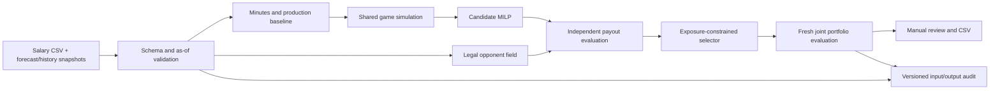

# Research-driven design and implementation plan

The three user-supplied documents are retained as [contest decision engine](research/contest-decision-engine.md), [quantitative architecture](research/quantitative-architecture.md), and [system overview](research/system-overview.md). They provide design hypotheses, not independently verified NBA accuracy or profit evidence. Their quoted MAE ranges and solver latency claims are not acceptance criteria. Vendor superlatives and suggested 100,000-draw counts are not assumed requirements.

The design prioritizes minutes and information timing, shared outcomes, legal construction, contest payouts, and independent evaluation. It starts with transparent baselines and adds complexity only after chronological tests establish an improvement.

## What exists now

| Component | Implemented behavior | Practical limit |
|---|---|---|
| Data | Canonical CSV and DK column aliases; optional historical logs; source/receipt timestamps | SportsDataIO/NBA adapters, response archives, polling, and exact-ID salary joins now implemented (see data.md); live feed access and source completeness remain unverified |
| Projection | Explicit minutes/FPPM imports or decayed historical baseline with shrinkage | No fitted gradient boosting, role/on-off model, learned scenario probabilities, or prop blending |
| Simulation | Availability draws, capped 240-minute team allocations, shared game lognormal factor, component Poisson counts and exact scoring, aggregate fallback | Heuristic distributions; not a possession-level simulator; no OT, foul/blowout states, assist-to-basket consistency, or learned covariance |
| Optimizer | SciPy/HiGHS MILP slot assignments; cap, two games, team limit, locks/excludes, distinct candidates | 8-second per-lineup budget, 0.1% optimality tolerance; feasible results may be incumbents rather than proven optima |
| Opponents | Gumbel/ownership-influenced optimization; legal rosters; achieved ownership and repeated entries | Not calibrated; fixed $45k field salary floor; no contest-trained co-ownership or actual-field import |
| Selection | Independent generation/evaluation/final draws; exact payout splitting; exposure MILP; cash/GPP objectives | Standalone-EV selection is an approximation; no return-risk budget, full joint portfolio optimization, or model sensitivity ensemble |
| Late swap | Complete original lineup validation, exact started-slot locks, exclude other started players | Single-entry only; pregame simulation/field approximation, no live remaining-points conditioning |
| Audit/replay | Successful requests/results, actual receipt time, model version, and seed in SQLite; retrieval/export | Append-only local raw-source archive now implemented; external write-once storage is absent, and imported timestamps remain assertions |
| UI | Imports, rules, projected distributions, ownership/exposure, portfolio metrics, CSV | Single-user local tool; no hosted authentication or background job infrastructure |
| Validation | Scoring/legality/payout tests; baseline walk-forward minutes and points errors | No historical contest ROI, calibration, or production news-latency study without data |

## Phase 1 — Trustworthy data and measured baseline

The executable baseline is delivered. Completing research validation requires real input data, rather than further synthetic results.

1. Obtain sample historical games, injury events, projections, and permitted contest exports from chosen providers. Map provider IDs to NBA and DraftKings IDs, retaining time-bounded mappings for trades and changes.
2. Store raw payloads append-only with source, provider event ID, event time, publication time, receipt time, payload hash, and license metadata. Keep revisions instead of overwriting earlier records. Use Parquet for immutable bulk storage; PostgreSQL for indexed production metadata after local SQLite.
3. Define slate, game, roster, injury-event, market-snapshot, projection-run, contest, entry, payout-tier, and actual-result schemas. Forecast references must identify every input snapshot and model artifact.
4. Expand the current player-level temporal evaluator to slate-grouped rolling train/tune/test windows. Fit all preprocessing using training data only; embargo delayed outcomes; never tune on the final test season. Freeze pre-lock and late-news snapshots separately.
5. Compare minutes × rate, last-N baselines, and time-matched licensed commercial projections on the same player universe. Include DNP/availability calibration and replacement-player slices. Report sample counts and slate-clustered uncertainty.

**Release gate:** reconstruct any selected historical decision using only received information available then; zero roster/scoring defects; reproducible out-of-sample baseline report. Backfilled final statuses and closing odds cannot substitute for original snapshots.

## Phase 2 — Learn basketball uncertainty

1. Build separate minutes and component-rate models. Start with gradient-boosted tabular means and quantiles, alongside the current transparent baseline. Candidate lagged features: EWMA minutes/rates, starter state, available teammate depth, coach/role, rest, schedule, pregame pace and market totals. Avoid unstable defense-vs-position and individual-matchup splits unless they improve holdouts.
2. Learn hierarchical teammate-absence effects with shrinkage based on shared minutes and role, rather than multiplying a star's usage into every teammate. Include unknown/probable/restricted/out scenarios and conditional starting/closing probabilities.
3. Fit rotation scenarios jointly with positional coverage and team-minute constraints; account for regulation, overtime, foul risk, restrictions, and blowouts. Sample model parameters separately from outcome randomness.
4. Model attempted/made twos, threes, free throws, rebounds, assists, defensive events, and turnovers. Conserve team possessions and rebounding opportunities; link assists to makes. Keep the current simulator as an ablation baseline.
5. If using residual copulas, estimate conditional correlations out of sample, regularize to a positive-semidefinite matrix, and validate joint tails. A fixed pair correlation is not a substitute for role and game-state mechanisms.
6. Blend market props and strong external projections only from licensed, timestamped snapshots; select blend weights on validation windows.

**Release gate:** improved held-out minutes/points MAE/RMSE and pinball loss; calibrated availability and interval coverage; plausible team totals and joint tail rates; no regression on late-news replacements. Publish failures as well as successes.

## Phase 3 — Contest-specific field and portfolio decisions

1. Train ownership by contest class (field size, fee, entry limits, slate size, news timing). Validate ownership sums near eight roster spots per entry, then individual and co-ownership residuals.
2. Fit legal lineup constructions to salary-used distributions, popular cores, stacking, player pairs, and exact duplicate counts. Use observed legal fields as a reference model; do not infer duplicate probability by multiplying player ownership.
3. Extend simulation evaluation in batches using vectorized matrix operations and streaming payout rank queries. Benchmark before raising limits to thousands of candidates, 150 own entries, 10k+ opponents, and adaptive simulation counts.
4. Preserve independent generation, selection, and finalist simulation samples. Quantify sensitivity to alternative player and field models, not only Monte Carlo standard error.
5. Add full-portfolio interaction-aware selection, return covariance diagnostics, probability of a major finish, and optional drawdown/bankroll constraints. Exposures are user constraints, not proof of optimal diversification.
6. Replay real contests with ties and entry fees; compare mean-maximization, no-field, no-correlation, no-scenario, and no-selection ablations. Report ROI confidence intervals clustered by slate, drawdowns, and profit concentration.

**Release gate:** calibrated field/duplicate behavior, stable finalist estimates under fresh samples and reasonable model perturbations, and reproducible historical contest reports. A winning streak alone does not establish an edge.

## Phase 4 — Live decision support

1. Add licensed news ingestion with bounded retries, deduplication, event versioning, stale-data alarms, and measured publication-to-forecast latency. Official injury-report schedules are season-specific inputs, not hard-coded assumptions.
2. Trigger affected-game forecasts from events and show exactly which players, minutes, and ownership estimates changed. Keep human overrides with authorship, reasons, expiration, and scenario history.
3. Condition remaining outcomes on actual box scores, live rotations, locked opponent entries, and observable ownership. Compare keeping a lineup with feasible swap continuations under the actual payout structure.
4. Add multi-entry exact slot preservation, late-flexibility placement, contingency branches for unresolved news, and entry-template round-trip validation. Include uncertainty that news may remain unresolved at lock.
5. Deploy authenticated UI/API with a durable job queue, cancellation, bounded resources, source-health metrics, database backups, audit retention, and rollback to a last-known-good forecast.

**Release gate:** shadow operation on real slates; correct started-slot handling and complete audit trails; documented freshness and failure behavior. Keep submission manual via supported exports. Review current provider licenses and contest rules before any integration beyond decision support.

## Research decisions

- NBA Classic is the initial format. Showdown captain multipliers and single-game constraints require a separate ruleset and are not silently mixed into Classic.
- Open-source HiGHS is sufficient for this initial scale. The documents' commercial-solver latency comparisons are workload-dependent and do not justify licensing Gurobi now.
- Team-minute totals and game factors are useful baseline dependencies; they do not justify claims of fully coherent possession simulation.
- Mean, ceiling, and payout objectives remain distinct. A ceiling-minus-ownership heuristic is not labeled EV.
- Provider access, historical ownership, and true as-of archives are the next critical dependencies. More simulation draws cannot correct missing or retrospectively leaked inputs.
